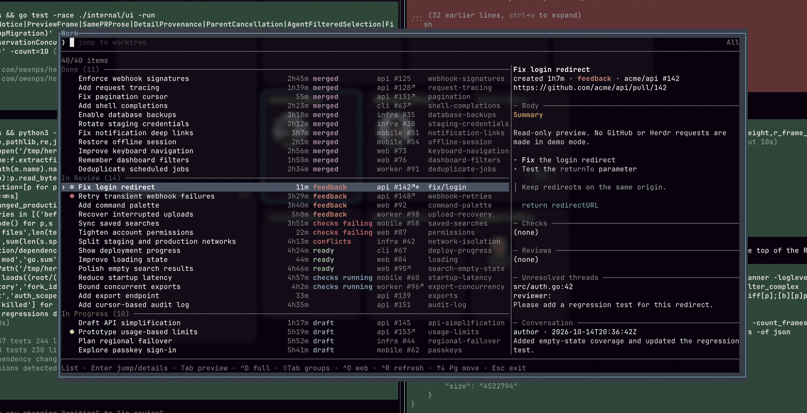

# herdr-prs


A Herdr popup for GitHub PRs and local branches, with fuzzy search,
workflow groups, and Markdown previews.

Easily navigate local worktree checkouts and review the status of their associated PRs.



## Quick start

### Requirements

| Dependency | Requirement |
| --- | --- |
| Herdr | 0.9.0+ on macOS or Linux |
| Go | 1.24+ during installation; not needed at runtime |
| Git | Available on `PATH` |
| GitHub CLI | `gh auth login`; also used to open PRs in your browser |
| GitHub | github.com repositories; Enterprise not supported |

`GH_TOKEN` or `GITHUB_TOKEN` can replace CLI authentication for API reads.
No plugin-owned token storage.

### Install

```sh
herdr plugin install owenps/herdr-prs
```

Herdr downloads the source and builds it automatically; Go must be installed.

### Bind a key

Add an unused binding to `~/.config/herdr/config.toml`:

```toml
[[keys.command]]
key = "prefix+p"
type = "plugin_action"
command = "herdr-prs.open"
description = "work"
```

```sh
herdr config check
herdr server reload-config
```

Open with your chosen binding. Configuration is never edited automatically;
your existing command-bar binding can stay unchanged.

## Your work

Your open PRs across GitHub, plus feature-branch work and linked PRs from the
active Herdr session, including work without a PR.

| Group | Work |
| --- | --- |
| Done | Merged PRs |
| In Review | Open, non-draft PRs |
| In Progress | Draft PRs and local work without a PR |
| Cancelled | Closed, unmerged PRs |

`↗` marks a PR with an existing navigation target; `*` marks your current checkout.
Ages show time in the group, not last activity. Local ages are approximate.
Native Nord sidebar dots show agent attention: amber `●` working, teal `●`
unread, green `○` idle; red `●` blocked and dim `·` unknown. Work without an
agent has no icon. The icon represents the preferred navigation worktree.

[Questions about missing PRs, ages, or refresh? →](docs/faq.md)

## Controls

Wide terminals (100+ columns) show a right-hand preview; narrower terminals use
fullscreen details. <kbd>⇥ Tab</kbd> changes focus; typing from details returns to search.

| Key | Action |
| --- | --- |
| Type | Fuzzy search |
| <kbd>↑</kbd> / <kbd>↓</kbd>, <kbd>PgUp</kbd> / <kbd>PgDn</kbd>, <kbd>Home</kbd> / <kbd>End</kbd> | Select work; scroll focused details |
| <kbd>⇥ Tab</kbd> | Switch list / preview focus in wide layout |
| <kbd>⇧</kbd> + <kbd>⇥ Tab</kbd> | Cycle All → Done → In Review → In Progress → Cancelled |
| <kbd>⏎ Enter</kbd> | From list: jump to existing target; unlinked work opens details |
| <kbd>Ctrl</kbd> + <kbd>D</kbd> | Toggle fullscreen details |
| <kbd>Ctrl</kbd> + <kbd>O</kbd> | Open PR in browser; no action for local work |
| <kbd>Ctrl</kbd> + <kbd>R</kbd> | Refresh/retry catalog and selected details, bypassing cache TTL |
| <kbd>Esc</kbd> | Return to list from details; otherwise close |
| <kbd>⌫ Backspace</kbd> | Edit search; when empty, return from details or close |

Cached data appears immediately and refreshes as needed. Failed refreshes keep
available data and show warnings. **No automatic GitHub polling**; ages tick and
Herdr agent states refresh read-only each second. Status reads never mark agents
seen; server unread state can differ from a client's sidebar.
Navigation revalidates the target checkout and branch before focusing it.

## Privacy and cache

> [!WARNING]
> PR titles, descriptions, reviews, and comments are cached locally, including
> private-repository content. Tokens are never stored. GitHub caches are isolated
> by authentication token; navigation links always come from current discovery.

| Platform | Cache directory |
| --- | --- |
| macOS | `~/Library/Caches/herdr-prs` |
| Linux | `$XDG_CACHE_HOME/herdr-prs`, or `~/.cache/herdr-prs` |

Delete the cache directory to clear persisted content and local clocks.
Markdown is sanitized; links/images never fetch remote content automatically.
`NO_COLOR` disables prose colors.

## Demo

From a local checkout, try **40 fictional items across six repositories**,
without authentication:

```sh
make demo        # terminal UI
make demo-popup  # Work popup inside Herdr
```

> [!TIP]
> For recording, browse the groups, search `settings`, then Tab into the preview
> and scroll. Use a wider terminal for side-by-side details.

Both demos disable navigation/browser actions and skip GitHub and real checkout
discovery. `demo-popup` builds and links this local plugin; it does not edit
keybindings. `--demo --list` prints the fixture catalog as JSON.

## Development

From the repository root:

```sh
make build
herdr plugin link "$PWD" --enabled
```

Then add the keybinding above. Verify:

```sh
make test
go vet ./...
./bin/herdr-prs --list  # live catalog as JSON; no focus changes
```

## License

[MIT](LICENSE).
